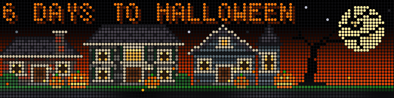

# Halloween Countdown

An animated Halloween countdown plugin for [LEDMatrix](https://github.com/ChuckBuilds/LEDMatrix).

A pumpkin-head kid and a little ghost go trick-or-treating down a street of
brick, stone and wooden houses under a sunset sky. Leaves blow, fog drifts,
the jack-o'-lanterns glow, and every 20-40 seconds something happens:

- a flock of bats sweeps across the sky
- a witch flies across the moon
- the kid stops at a door, candy flies into the bag, and the bag gets fuller
- a monster pops out of a bush and the ghost hides behind the kid
- a big gust of leaves blows down the street
- a jack-o'-lantern winks

A shadowy figure, a witch or a black cat also appears in an upstairs window
now and then.



The days left show in the top-left corner. On October 31 it reads
**HAPPY HALLOWEEN**, with extra pumpkins and bats; from November 1 it counts
to next year's Halloween.

Designed for **128x32** (two 64x32 panels chained).

## Install

1. Open the LEDMatrix web interface (`http://<your-pi>:5000`).
2. Go to **Plugin Manager**, find **Install from GitHub → Install Single Plugin**.
3. Paste this repository's URL and click **Install**, then confirm the
   unverified-plugin warning.
4. Enable **Halloween Countdown** in the Installed Plugins list and restart the
   display.

## Settings

| Setting | Default | What it does |
|---|---|---|
| `display_duration` | 30 | Seconds on screen each rotation |
| `show_countdown` | on | Show the days-to-Halloween text |
| `brightness` | 100 | Brightness of this scene (%), on top of LEDMatrix's overall brightness |
| `sunset_glow` | full | The orange glow behind the houses: full, soft or off |
| `fog` | 100 | Fog thickness (%): 0 = off, 200 = extra thick |
| `leaves` | 10 | How many leaves blow across (0 = off, up to 20) |
| `countdown_color` | orange | Colour of the countdown text |
| `animation_speed` | 1.0 | How fast everything moves (0.5 = half, 2 = double) |
| `surprise_every_seconds` | 30 | Roughly how often a surprise happens |
| `animation_fps` (advanced) | 30 | Frames per second; lower it if the Pi struggles |

The date follows the timezone set in LEDMatrix's General settings.

## Changing the artwork

Everything is drawn in [`halloween_scene.py`](halloween_scene.py). Small
characters (the kid, ghost, pumpkins, bats, witch, monster) are text pictures:
each letter is one LED and the colour table next to it says what each letter
means. The houses are described by a few numbers in `HOUSES` (position, size,
material, windows, door).

To preview a change without the Pi, run this from your LEDMatrix folder (it
borrows LEDMatrix's fonts) and open the GIFs in a web browser:

```bash
pip3 install pillow
cd ~/path/to/LEDMatrix
python3 ~/path/to/ledmatrix-halloween-countdown/preview.py
```

It writes `preview/animation.gif` (a walk across the street) and
`preview/surprises.gif` (each surprise, back to back).

## Releasing a change

Bump `version` in `manifest.json` (e.g. `1.0.0` → `1.1.0`), commit and push.
Then use **Update** on the plugin in the Plugin Manager.
